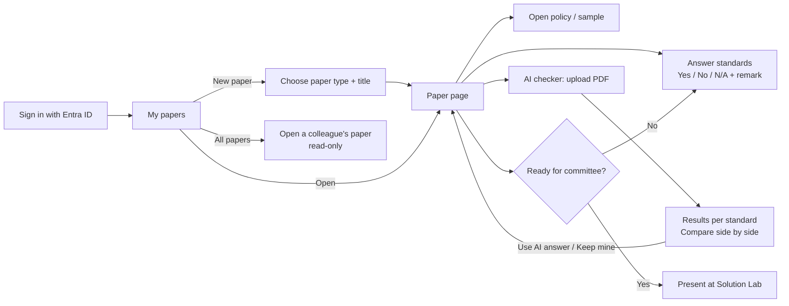
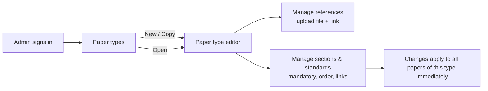

# 01 · Product overview

## 1. Problem

Papers presented to the Solution Lab committee are often **non-standard**:
missing mandatory controls (CASB for admin access, PAM, backup ownership, data
segregation, vendor support model…), or claiming "Yes" without evidence in the
paper. The committee then sends them back, which wastes everyone's time.

## 2. Goal

Give the Solution Architect a **self-check before committee**:

- the exact list of standards their paper type must follow,
- one click to the policy / sample / template that explains each standard,
- an AI check of their actual PDF against those references,
- a clear verdict: **Ready for committee** or **N things to fix**.

### Success measures (to agree with the business owner)

| Measure | Target (proposal) |
|---------|-------------------|
| Papers returned by committee for missing standards | −50 % within 6 months |
| Papers AI-checked before submission | ≥ 80 % |
| Time for an architect to self-check a paper | < 30 minutes |

## 3. Users and roles

| Role | Who | What they do | Entra App Role |
|------|-----|--------------|----------------|
| **Solution Architect** | Anyone writing a Solution Lab paper | Creates papers, answers standards, runs the AI check. Can **view** (read-only) any other paper. | `Architect` |
| **Admin** | Standards / architecture governance team | Maintains paper types, standards and reference documents. Can view any paper. | `Admin` |

- Everyone signs in with **Microsoft Entra ID** (company account).
- A person can have both roles. The **mode switch** (Solution Architect | Admin)
  in the top bar is shown only to people with the `Admin` role.
- People without either role see an "access not granted" page with
  instructions for requesting access.

## 4. Scope

### In scope (v1)

1. **Papers** — *My papers* (create, rename, delete your own) and *All papers* (browse and open anyone's paper read-only).
2. **Paper validation page** — one long form grouped by section, answering
   Yes / No / N/A with remarks, mandatory flags, filters, a section navigator
   and a readiness panel.
3. **References** — clickable policies, samples, templates and guides on every
   standard.
4. **AI paper checker** — a chat panel to upload PDFs, see progress and
   per-standard results, compare pages side by side, apply the AI's answer or
   keep your own, and ask follow-up questions.
5. **Admin: paper types** — create, copy and delete paper types; manage
   sections, standards (mandatory flag, ordering) and reference documents
   (file upload + optional link).
6. **Entra ID sign-in** with role-based access.
7. **Switchable AI provider**: Gemini (default) or AWS Bedrock.

### Out of scope (v1) — removed on purpose to keep it simple

These existed in earlier prototype versions and were removed at the product
owner's request. **Do not build them** unless the scope changes:

- sign-off workflow (Business Owner, Security Architect, PM…),
- committee decision / approval status,
- printable checklist, dashboards and KPIs,
- versioning or publishing of standards (admin changes apply immediately),
- co-editing papers (others can **view**, only the owner edits),
- keeping uploaded PDFs or chat history longer than 7 days.

## 5. Main user journeys

## 6. Glossary

| Term | Meaning |
|------|---------|
| **Paper** | One Solution Lab submission an architect is preparing, e.g. "Enterprise PPM SaaS". |
| **Paper type** | A checklist template such as *SaaS*, *Cloud Platform*, *Infrastructure*. In earlier prototypes this was called a *collection*. |
| **Section** | A group of standards inside a paper type, e.g. "A. Identity & Access Management". Shown with a letter (A, B, C…). |
| **Standard** | One requirement the paper must address, e.g. "MFA enforced". Numbered 1…N across the paper type. |
| **Mandatory** | A standard that must **not** be answered "No" for the paper to be ready. (Replaces the old "mandatory gate" idea.) |
| **Answer** | The architect's Yes / No / N/A for a standard, plus a remark. |
| **Remark** | Free text. **Required** for No (the gap and the plan) and for N/A (why it doesn't apply). |
| **Reference** | A Policy, Sample, Template or Guide document linked to standards. Has an uploaded file and optionally an intranet link. |
| **Check** | One run of the AI checker over the uploaded PDF(s) of a paper. |
| **Verdict** | The AI's result per standard: *Complies*, *Partially*, *Does not comply*, *Not found in paper*. |
| **AI issue** | The AI's verdict disagrees with the architect's answer (see FR-AI-08). |
| **Keep mine** | The architect overrides an AI issue and keeps their own answer. |
| **Readiness** | The rule set that decides "Ready for committee" (see FR-RDY). |
