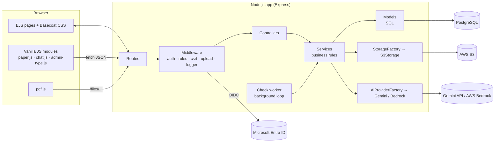
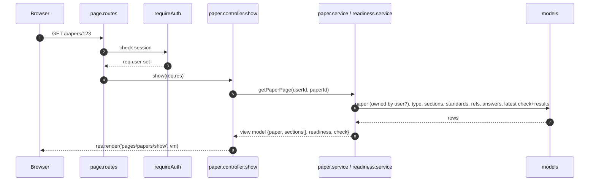
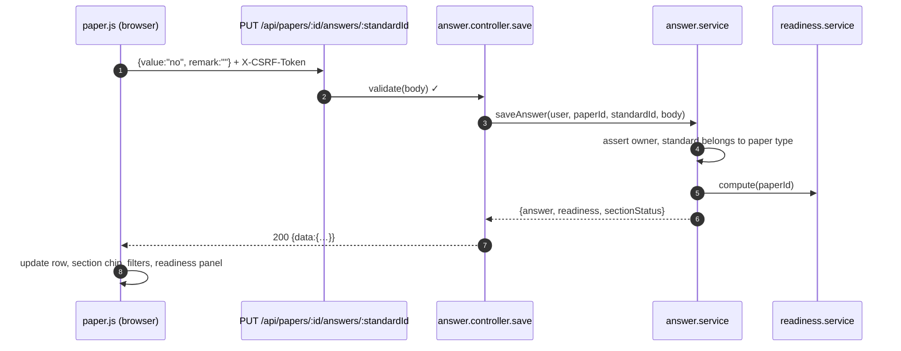
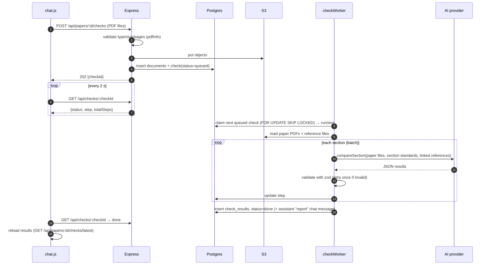

# 04 · Architecture

## 1. Tech stack (keep it simple)

| Concern | Choice | Why |
|---------|--------|-----|
| Runtime | **Node.js 22 LTS** | Long-term support, native `fetch`, `node:test`. |
| Web framework | **Express 4** | Well known, small, huge community. |
| Views | **EJS** (server-rendered) + `include` partials | No front-end framework to learn. |
| Front-end JS | **Vanilla JS ES modules** in `public/js/` | One small module per page. No bundler. |
| UI kit | **Basecoat UI** + **Tailwind CSS v4** (CLI build) | shadcn/ui look without React. |
| PDF in the browser | **pdf.js** (`pdfjs-dist`) | Page thumbnails and previews. |
| PDF on the server | **pdf-lib** | Page count, encryption check. |
| Database | **PostgreSQL 16** with **`pg`** | Plain SQL, no ORM. |
| Migrations | Numbered `.sql` files + a tiny runner script | Nothing magic. A junior can read every migration. |
| Sessions | `express-session` + `connect-pg-simple` | Sessions in Postgres, so several instances work. |
| Auth | **`@azure/msal-node`** (OIDC auth-code flow + PKCE) | Microsoft's official library for Entra ID. |
| File storage | **AWS S3** via `@aws-sdk/client-s3` (MinIO locally) | Decided by the product owner. |
| Uploads | `multer` (memory storage, size limits) | Simple; files go straight to S3. |
| AI | `@google/genai` (Gemini) and `@aws-sdk/client-bedrock-runtime` (Bedrock) | **Official SDKs only, no AI framework.** |
| Validation | `zod` | Validates request bodies and AI JSON output with one tool. |
| Logging | `pino` + `pino-http` | Fast JSON logs with request IDs. |
| Security headers | `helmet`, `express-rate-limit` | Standard hardening. |
| Tests | `node:test` + `supertest` | Built into Node; no test framework to learn. |
| Lint / format | ESLint + Prettier | Same style for everyone. |

> "No AI framework" means **no LangChain, LlamaIndex, Vercel AI SDK** or
> similar. We call the providers' own SDKs and keep prompts in Markdown files
> (see [07](07-ai-integration.md)).

## 2. The big picture



## 3. MVC + Services + Factories + Utilities — who does what

Think of a request as passing through layers. **Each layer only talks to the
layer below it.**

| Layer | Folder | Does | Never does |
|-------|--------|------|-----------|
| **Route** | `src/routes/` | Maps URL + method → middleware + controller function. | Logic. |
| **Middleware** | `src/middleware/` | Cross-cutting concerns: sign-in, roles, CSRF, uploads, logging, errors. | Business rules. |
| **Controller (C)** | `src/controllers/` | Reads `req` (params, body, user), calls **one** service method, sends the response (`res.render` or `res.json`). | SQL, AI calls, business rules. |
| **Service** | `src/services/` | Business rules: readiness, AI issue rules, ownership checks, transactions. Combines models, storage and AI. | Touching `req` / `res`. |
| **Model (M)** | `src/models/` | SQL for one table (or a few tightly related tables). Returns plain objects in camelCase. | Business rules. |
| **View (V)** | `src/views/` | EJS templates. Display only. | Calling the database. |
| **Factory** | `src/factories/` | Builds the right implementation from config (`AiProviderFactory`, `StorageFactory`). | Doing the work itself. |
| **Provider** | `src/providers/` | One implementation per external service (Gemini, Bedrock, S3). All implementations of an interface have the **same methods**. | Business rules. |
| **Validator** | `src/validators/` | zod schemas describing valid params / body for each route. | Business rules. |
| **Utility** | `src/utils/` | Small reusable helpers: `logger`, `asyncHandler`, `errors`, `db`, `promptLoader`, `pdfInfo`, `readinessRules`. | Depending on Express `req` / `res`. |
| **Worker** | `src/workers/` | Background loop that runs queued AI checks. | HTTP. |

### 3.1 Why factories?

The rest of the code must not care **which** AI or storage it uses.

```js
// src/factories/aiProviderFactory.js
const config = require('../config');
const { GeminiProvider } = require('../providers/ai/geminiProvider');
const { BedrockProvider } = require('../providers/ai/bedrockProvider');
const { ConfigError } = require('../utils/errors');

let instance; // created once, reused (singleton)

function getAiProvider() {
  if (instance) return instance;
  switch (config.ai.provider) {
    case 'gemini':  instance = new GeminiProvider(config.ai.gemini); break;
    case 'bedrock': instance = new BedrockProvider(config.ai.bedrock); break;
    case 'fake':    // local development and tests only — config validation rejects it in production
      instance = new (require('../providers/ai/fakeAiProvider').FakeAiProvider)(); break;
    default: throw new ConfigError(`Unknown AI_PROVIDER "${config.ai.provider}"`);
  }
  return instance;
}

module.exports = { getAiProvider };
```

Changing `AI_PROVIDER` (`gemini` on a laptop, `bedrock` in UAT / production)
and restarting is all it takes to switch. `StorageFactory` follows the same pattern (only `s3` exists in v1, but
tests use an in-memory fake).

## 4. Folder structure

```
paper-standards-check/
├─ src/
│  ├─ server.js                 # starts HTTP server + check worker, graceful shutdown
│  ├─ app.js                    # builds the Express app (used by server.js and tests)
│  ├─ config/
│  │  └─ index.js               # reads env vars ONCE, validates with zod, exports a frozen object
│  ├─ routes/
│  │  ├─ index.js               # mounts all routers
│  │  ├─ auth.routes.js         # /auth/login, /auth/callback, /auth/logout
│  │  ├─ page.routes.js         # HTML pages (architect + admin)
│  │  ├─ paper.api.routes.js    # /api/papers/...
│  │  ├─ check.api.routes.js    # /api/checks/...
│  │  ├─ admin.api.routes.js    # /api/admin/...
│  │  └─ file.routes.js         # /files/... (streams from S3 after permission check)
│  ├─ middleware/
│  │  ├─ requireAuth.js         # redirects / 401 if not signed in
│  │  ├─ requireRole.js         # requireRole('Admin')
│  │  ├─ csrf.js                # token in session, checked on POST/PATCH/PUT/DELETE
│  │  ├─ upload.js              # multer configs: paperPdfUpload, referenceFileUpload
│  │  ├─ requestLogger.js       # pino-http with requestId
│  │  ├─ notFound.js            # 404
│  │  └─ errorHandler.js        # the ONE place errors become responses
│  ├─ validators/              # zod schemas per route group (paper, answer, check, admin…)
│  ├─ controllers/
│  │  ├─ auth.controller.js
│  │  ├─ paper.controller.js
│  │  ├─ answer.controller.js
│  │  ├─ check.controller.js
│  │  ├─ chat.controller.js
│  │  ├─ file.controller.js
│  │  └─ admin/
│  │     ├─ paperType.controller.js
│  │     ├─ section.controller.js
│  │     ├─ standard.controller.js
│  │     └─ reference.controller.js
│  ├─ services/
│  │  ├─ user.service.js
│  │  ├─ paper.service.js
│  │  ├─ answer.service.js
│  │  ├─ readiness.service.js   # uses utils/readinessRules.js
│  │  ├─ check.service.js       # create check, run check (used by worker), apply / keep
│  │  ├─ chat.service.js
│  │  ├─ paperType.service.js   # incl. copy paper type
│  │  └─ reference.service.js
│  ├─ models/
│  │  ├─ user.model.js
│  │  ├─ paper.model.js
│  │  ├─ answer.model.js
│  │  ├─ paperType.model.js
│  │  ├─ section.model.js
│  │  ├─ standard.model.js
│  │  ├─ reference.model.js
│  │  ├─ document.model.js
│  │  ├─ check.model.js
│  │  ├─ checkResult.model.js
│  │  └─ chatMessage.model.js
│  ├─ factories/
│  │  ├─ aiProviderFactory.js
│  │  └─ storageFactory.js
│  ├─ providers/
│  │  ├─ ai/
│  │  │  ├─ aiProvider.js       # JSDoc "interface" + shared helpers
│  │  │  ├─ geminiProvider.js
│  │  │  ├─ bedrockProvider.js
│  │  │  └─ fakeAiProvider.js   # returns fixture results; local dev + tests only
│  │  └─ storage/
│  │     ├─ s3Storage.js
│  │     └─ memoryStorage.js    # tests only
│  ├─ ai/
│  │  ├─ prompts/               # Markdown prompt templates (see 07)
│  │  │  ├─ compare-section.md
│  │  │  └─ answer-question.md
│  │  └─ schemas/
│  │     └─ compareResult.js    # zod schema + JSON schema for structured output
│  ├─ workers/
│  │  └─ checkWorker.js
│  ├─ utils/
│  │  ├─ logger.js
│  │  ├─ errors.js              # AppError + subclasses
│  │  ├─ asyncHandler.js
│  │  ├─ db.js                  # pg Pool, query(), withTransaction()
│  │  ├─ promptLoader.js        # loads .md, fills {{placeholders}}
│  │  ├─ pdfInfo.js             # page count, encrypted?, magic-bytes check
│  │  ├─ readinessRules.js      # PURE functions shared with the browser
│  │  └─ validate.js            # validate(schema) middleware using zod
│  ├─ views/
│  │  ├─ layouts/main.ejs       # <html>, top bar, toasts container, scripts
│  │  ├─ partials/              # topbar, paperCard, sectionCard, standardRow, aiLine, dialogs…
│  │  ├─ pages/
│  │  │  ├─ papers/index.ejs    # My papers
│  │  │  ├─ papers/show.ejs     # Paper page
│  │  │  ├─ admin/types.ejs
│  │  │  ├─ admin/type.ejs
│  │  │  └─ error.ejs, forbidden.ejs, notFound.ejs
│  │  └─ strings/en.js          # all user-facing text
│  └─ styles/app.css            # Tailwind + Basecoat imports + status tokens
├─ public/
│  ├─ css/app.css               # BUILT by Tailwind CLI (git-ignored)
│  ├─ js/
│  │  ├─ lib/api.js             # fetch wrapper: JSON, CSRF header, error → toast
│  │  ├─ lib/dom.js             # $, $$, escapeHtml, debounce
│  │  ├─ lib/toast.js
│  │  ├─ lib/pdfView.js         # render a PDF page into a canvas (pdf.js)
│  │  ├─ shared/readinessRules.js  # copied at build from src/utils (same file)
│  │  ├─ pages/papers.js
│  │  ├─ pages/paper.js
│  │  ├─ pages/chat.js
│  │  ├─ pages/adminTypes.js
│  │  └─ pages/adminType.js
│  └─ img/
├─ db/
│  ├─ migrations/001_init.sql, 002_….sql
│  ├─ seed/001_paper_types.sql  # SaaS, Cloud Platform, Infrastructure from the prototype
│  └─ migrate.js                # tiny runner: applies new files in order, records them
├─ tests/
│  ├─ helpers/                  # fakeAuth (test env only), db reset, agentAs(user)
│  ├─ unit/                     # rules, services with fakes, prompt loader
│  ├─ integration/              # supertest against app + test DB
│  └─ fixtures/                 # sample PDFs, recorded AI responses
├─ docs/                        # these documents
├─ docker-compose.yml           # postgres + minio for local dev
├─ .env.example
├─ package.json
└─ README.md                    # quick start → links to docs/
```

## 5. Request flow examples

### 5.1 Page request: open a paper



### 5.2 API request: answer a standard



## 6. Shared rules (server + browser)

`src/utils/readinessRules.js` holds **pure functions** (no I/O):

- `needsRemark(answer)`
- `aiAnswerFor(verdict)` → `'yes' | 'no'`
- `aiIssue(answer, result, standard, kept)` → `{ level, messageKey } | null`
- `sectionStatus(standards, answers, results, kept)`
- `readiness({ standards, answers, latestCheck, results, kept })` → `{ ready, gaps[], answered, total, mandatory, mandatoryMet }`

The server uses them in `readiness.service`. The browser gets the **same
file** (copied to `public/js/shared/` by `npm run build`), so the UI updates
instantly without waiting for the server. The server result is the source of
truth: after every save, the API response overwrites the browser's guess.

## 7. Background AI checks



Rules for the worker:

1. It runs **inside the app process**, started by `server.js` (no Redis or
   queue product). It polls every `CHECK_WORKER_INTERVAL_MS` (default 2000).
2. It claims jobs with `SELECT … FOR UPDATE SKIP LOCKED`, so several app
   instances never run the same check twice.
3. Concurrency per instance: `CHECK_WORKER_CONCURRENCY` (default 2).
4. A check stuck in `running` for longer than `CHECK_TIMEOUT_MS` (default 10
   min) is marked `failed` at startup and by a sweep every minute.
5. On shutdown (`SIGTERM`), stop claiming new jobs, wait up to 30 s for running
   ones, then exit. Unfinished jobs are retried after the timeout sweep.
6. Steps for the progress UI: 1 = reading PDF, 2 = reading content, 3 =
   comparing (advances per section batch), 4 = checking / saving.
7. The same worker module runs the **retention job** (FR-RET-01) once a day.
   To stop two instances doing it at the same moment, it takes a Postgres
   advisory lock (`pg_try_advisory_lock`) and skips the run if another
   instance holds it.

## 8. Non-functional requirements

| ID | Requirement |
|----|-------------|
| NFR-PERF-01 | Server-rendered pages respond in < 500 ms (p95) excluding network, for paper types up to 100 standards. |
| NFR-PERF-02 | Answer / remark saves respond in < 300 ms (p95). |
| NFR-PERF-03 | An AI check for a 30-page PDF and 35 standards completes in < 3 minutes (p90). |
| NFR-REL-01 | A failed AI call is retried **once** with backoff for 429 / 5xx / timeouts. A permanent failure marks the check `failed` with a friendly reason. |
| NFR-REL-02 | The app is **stateless** apart from Postgres and S3, so 2+ instances can run behind a load balancer. |
| NFR-OPS-01 | `GET /health` returns 200 when the app is up; `GET /health/ready` also checks the DB and S3 (used by the load balancer). |
| NFR-MAINT-01 | Every exported function has a JSDoc comment (what, params, returns, throws). |
| NFR-MAINT-02 | Unit-test coverage ≥ 80 % for `services/` and `utils/`. |
| NFR-COMPAT-01 | Latest two versions of Edge and Chrome (company standard), plus Safari / Firefox best effort. |
