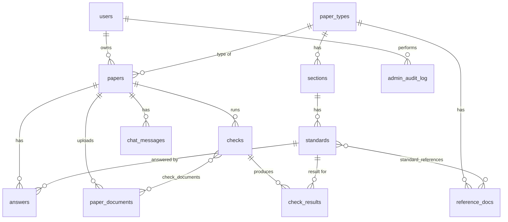

# 05 · Data model (PostgreSQL)

## 1. Conventions

- Table names: **snake_case, plural** (`papers`). Column names: snake_case.
- Primary keys: `id uuid primary key default gen_random_uuid()`.
- Every table has `created_at timestamptz not null default now()`. Mutable
  tables also have `updated_at` (set by the model on update).
- **Soft delete**: tables that support Undo or audit have `deleted_at
  timestamptz`. Normal queries **always** add `where deleted_at is null`.
- Models convert snake_case rows to **camelCase** objects (`paper_type_id` →
  `paperTypeId`) in one helper (`utils/db.js → toCamel`).
- Ordering inside a parent uses `position integer`. Moving swaps the positions
  of two rows in a transaction.
- Never build SQL by string concatenation with values —
  **always use parameters** (`$1, $2`).

## 2. Entity relationship diagram

## 3. Tables

### 3.1 `users`

| Column | Type | Notes |
|--------|------|-------|
| id | uuid PK | |
| entra_oid | text unique not null | Entra object ID (`oid` claim). **Never** use email as the key. |
| email | text | `preferred_username` / `email` claim. |
| display_name | text | |
| role | text not null default `'architect'` | in (`architect`,`admin`). Set by admins (D-26), never from the token. |
| status | text not null default `'active'` | in (`active`,`disabled`) (D-28). |
| last_login_at | timestamptz | |
| created_at, updated_at | timestamptz | |

Roles are stored here (D-26) and re-read on every request, so a change by an
admin applies immediately.

### 3.1a `local_admins` (D-27)

| Column | Type | Notes |
|--------|------|-------|
| id | uuid PK | |
| username | text unique not null | 3–40 lowercase letters, digits, `.`, `-`, `_`. |
| password_hash | text not null | `scrypt$N$r$p$salt$hash` (`utils/password.js`). |
| must_change_password | boolean not null default true | Temporary passwords must be changed at first sign-in. |
| password_changed_at | timestamptz not null | A reset signs out existing sessions (compared with the session). |
| failed_attempts | integer not null default 0 | Reset on success. |
| locked_until | timestamptz | Set after 5 failures (15 min). |
| created_by | text | `bootstrap`, `cli` or a username. |
| last_login_at, created_at | timestamptz | |

### 3.2 `paper_types`

| Column | Type | Notes |
|--------|------|-------|
| id | uuid PK | |
| name | text not null | Unique among non-deleted rows (partial unique index). |
| description | text | |
| created_at, updated_at, deleted_at | timestamptz | |

### 3.3 `sections`

| Column | Type | Notes |
|--------|------|-------|
| id | uuid PK | |
| paper_type_id | uuid FK → paper_types | |
| title | text not null | |
| position | integer not null | 0-based order. Letter A, B, C… is **computed** for display. |
| created_at, updated_at, deleted_at | | |

### 3.4 `standards`

| Column | Type | Notes |
|--------|------|-------|
| id | uuid PK | |
| section_id | uuid FK → sections | |
| title | text not null | ≤ 500 chars (check constraint). Was `text` before migration 002 (D-37). |
| description_html | text not null default '' | Optional rich text, cleaned by `utils/richText.js` (D-37). |
| source_standard_id | uuid FK → standards | Live link (D-38): when set, title, description, mandatory flag and references are read from the source; own content columns are ignored. |
| updated_by | text | "Last edited by" snapshot (D-37). |
| is_mandatory | boolean not null default false | |
| position | integer not null | Order within the section. The number 1…N is **computed**. |
| created_at, updated_at, deleted_at | | |

### 3.5 `reference_docs` (references)

> `references` is a reserved word in SQL. Name the table **`reference_docs`**.

| Column | Type | Notes |
|--------|------|-------|
| id | uuid PK | |
| paper_type_id | uuid FK → paper_types | **Legacy, nullable** (D-37): references are a shared library; kept only as a record of origin. |
| type | text not null | check in (`Policy`,`Sample`,`Template`,`Guide`) |
| title | text not null | |
| note | text | Plain-text summary (≤ 500) of `guidance_html`, for tooltips and the AI prompt. |
| guidance_html | text not null default '' | Rich-text guidance "what should the architect look for?" (D-37). |
| updated_by | text | "Last edited by" snapshot (D-37). |
| url | text | Optional intranet link, must start with `https://`. |
| s3_key | text not null | Uploaded file. |
| file_name | text not null | Original name (display only). |
| mime_type | text not null | `application/pdf`, `image/png`, `image/jpeg`. |
| size_bytes | integer not null | |
| page_count | integer | PDFs only. |
| created_at, updated_at, deleted_at | | |

### 3.6 `standard_references` (many-to-many)

| Column | Type | Notes |
|--------|------|-------|
| standard_id | uuid FK → standards | |
| reference_id | uuid FK → reference_docs | |
| | | PK (standard_id, reference_id) |

### 3.7 `papers`

| Column | Type | Notes |
|--------|------|-------|
| id | uuid PK | |
| owner_id | uuid FK → users | Index. |
| paper_type_id | uuid FK → paper_types | Cannot change after insert. |
| title | text not null | 3–150 chars. |
| vendor | text | ≤ 150 chars. |
| created_at, updated_at, deleted_at | | `updated_at` also bumps when answers / checks change (for "newest first"). |

### 3.8 `answers`

| Column | Type | Notes |
|--------|------|-------|
| paper_id | uuid FK → papers | |
| standard_id | uuid FK → standards | |
| value | text | null, or in (`yes`,`no`,`na`). Null = cleared. |
| remark | text not null default '' | ≤ 2000 chars. |
| updated_at | timestamptz | |
| | | PK (paper_id, standard_id) — use `INSERT … ON CONFLICT DO UPDATE` (upsert). |

### 3.9 `paper_documents`

| Column | Type | Notes |
|--------|------|-------|
| id | uuid PK | |
| paper_id | uuid FK → papers | |
| s3_key | text not null | `papers/{paperId}/{documentId}.pdf` |
| file_name | text not null | |
| size_bytes | integer not null | |
| page_count | integer not null | |
| is_current | boolean not null default true | A new upload sets the previous documents to false. |
| created_at | timestamptz | |

### 3.10 `checks`

| Column | Type | Notes |
|--------|------|-------|
| id | uuid PK | |
| paper_id | uuid FK → papers | |
| requested_by | uuid FK → users | |
| status | text not null | in (`queued`,`running`,`done`,`failed`) |
| step | smallint not null default 0 | 0–4, for the progress UI. |
| provider | text | `gemini` / `bedrock` |
| model | text | Model ID used. |
| prompt_version | text | From the prompt file front matter. |
| standards_snapshot | jsonb | `[{standardId, number, text, isMandatory}]` at run time — explains old results after admin edits. |
| error_code | text | e.g. `AI_TIMEOUT`, `AI_INVALID_RESPONSE`. |
| error_message | text | Friendly text shown to the user. |
| input_tokens, output_tokens | integer | For cost tracking. |
| started_at, finished_at, created_at | timestamptz | |

Index: `(status, created_at)` for the worker; `(paper_id, created_at desc)`.
Partial unique index: one active check per paper —
`unique (paper_id) where status in ('queued','running')`.

### 3.11 `check_documents`

| check_id → checks | document_id → paper_documents | PK (check_id, document_id) |
|---|---|---|

### 3.12 `check_results`

| Column | Type | Notes |
|--------|------|-------|
| id | uuid PK | |
| check_id | uuid FK → checks | |
| standard_id | uuid FK → standards | |
| verdict | text not null | in (`comply`,`partial`,`gap`,`none`) |
| page | integer | Page **within** `document_id` (1-based). Null when `none`. |
| document_id | uuid FK → paper_documents | Which uploaded file the page belongs to. |
| area | text | in (`text`,`diagram`,`table`) |
| bbox | jsonb | Optional `{x,y,w,h}` as fractions 0–1 if the model returns them. |
| finding | text not null | ≤ 300 chars. |
| reference_id | uuid FK → reference_docs | Nullable. |
| reference_page | integer | Nullable. |
| confidence | numeric(3,2) | 0–1, nullable. |
| kept_by_user_at | timestamptz | Set by **Keep mine** (FR-AI-10). |
| | | Unique (check_id, standard_id) |

### 3.13 `chat_messages`

| Column | Type | Notes |
|--------|------|-------|
| id | uuid PK | |
| paper_id | uuid FK → papers | |
| role | text | in (`user`,`assistant`) |
| kind | text | in (`text`,`files`,`report`,`compare`,`gaps`,`refs`,`summary`,`error`) |
| content | jsonb | `text` → `{text}`; `files` → `{files:[{name,size}]}`; `report` → `{checkId}`; `compare` → `{standardId, checkId}`… The front end renders cards from live data. |
| created_at | timestamptz | |

### 3.14 `admin_audit_log` — not used (D-33)

Created by migration 001 but **not written** since D-33. Kept to avoid a destructive migration;
remove it in a later migration if it stays unused.

| Column | Type | Notes |
|--------|------|-------|
| id | bigserial PK | |
| user_id | uuid FK → users | Nullable: set when an Entra admin acted. |
| local_admin_id | uuid FK → local_admins | Nullable: set when a local admin acted. Exactly one of the two is set (check constraint). |
| action | text | e.g. `standard.update`, `reference.delete`, `user.update` |
| entity_type, entity_id | text, uuid | |
| before, after | jsonb | |
| created_at | timestamptz | |

### 3.15 `session` (created by `connect-pg-simple`)

Use the library's standard table. Add it in a migration, not at runtime.

### 3.16 `schema_migrations`

Used by `db/migrate.js`: `filename text primary key, applied_at timestamptz`.

## 4. Important queries (write them in the models)

| Need | Model method | Notes |
|------|--------------|-------|
| Paper page data | `standardModel.listForPaperType(typeId)` | One query joining sections + standards ordered by `sections.position, standards.position`; compute `number` with `row_number() over (...)`. |
| Latest completed check | `checkModel.findLatestDone(paperId)` | `order by finished_at desc limit 1`. |
| Worker claim | `checkModel.claimNext()` | `update checks set status='running', started_at=now() where id = (select id from checks where status='queued' order by created_at for update skip locked limit 1) returning *` |
| Papers using a type | `paperModel.countByType(typeId)` | Used to disable Delete type. |
| Copy paper type | `paperTypeService.copy()` | One **transaction**: new type → sections → standards → references (copy S3 objects) → links, mapping old IDs to new ones. |

## 5. Retention (FR-RET)

| Data | Deleted when | How |
|------|--------------|-----|
| `paper_documents` + S3 object | `created_at` older than 7 days | Delete the S3 object first, then the row. `check_results.document_id` is set to null (`on delete set null`). |
| `chat_messages` | `created_at` older than 7 days | `delete … where created_at < now() - interval '7 days'` |
| Soft-deleted papers and admin items | `deleted_at` older than 7 days | Hard delete with `on delete cascade` to children; S3 objects first. |
| `check_results`, `answers` | Not by the retention job | Removed only when their paper is purged. |

Add indexes on `paper_documents(created_at)`, `chat_messages(created_at)`
and `deleted_at` columns so the job stays fast.

## 6. Seed data

`npm run seed` (`db/seed/seed.js`, D-31) loads the three paper types from the prototype (SaaS with
33 standards in 5 sections, Cloud Platform, Infrastructure) with their mandatory flags, references and
links (data in `db/seed/paperTypes.js`). Each reference gets a **placeholder PDF generated with
pdf-lib** (its title and note) uploaded to the configured S3 bucket. It skips paper types that
already exist (by name) and refuses to run when `NODE_ENV=production`. Real policy documents are
uploaded by admins in each environment.
